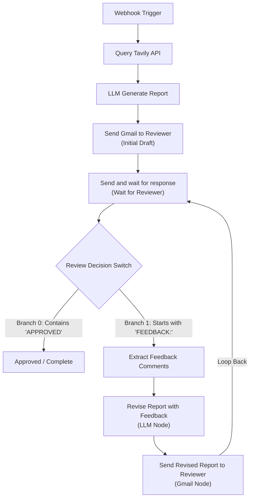

# n8n Research Pipeline

A minimal, focused research ingestion pipeline workspace connecting a lightweight dark-themed web form to an n8n workflow, the Tavily Search API, an LLM report generator, human-in-the-loop review via Gmail, and an automated feedback revision loop.

## Workspace Structure

```
/home/muaz/projects/n8n-research-pipeline/
├── index.html        # Minimalist single-column input form (no card containers)
├── style.css         # Dark slate theme styling with emerald green accent
├── app.js            # Form submission handler dispatching JSON to n8n webhook
├── workflow.json     # Complete n8n workflow with feedback loop (Webhook -> Tavily -> LLM -> Gmail -> Wait -> Switch -> Revise -> Loop)
└── README.md         # Setup and usage documentation
```

---

## 1. Web Form Interface

### Features
- **Design Specifications**: Minimalist, dark-themed UI featuring a deep dark slate palette (`#0b1120`, `#0f172a`, `#1e293b`) with emerald green accent highlights (`#10b981`).
- **Layout**: Single-column stacked vertical layout with no card containers, bounding boxes, or card shadows. Form fields flow directly within the document canvas.
- **Fields Collected**:
  - `topic`: Primary query string passed directly to the search provider.
  - `subtopics`: Auxiliary domains or secondary angles for targeted search expansion.
  - `description`: Detailed research context, criteria, or constraints.
  - `reviewer_email`: Email address for downstream alert and review stages.
- **Client Logic (`app.js`)**: Asynchronously submits the JSON payload via `fetch` to the configured n8n webhook and displays responsive, minimalist feedback.

### Quick Preview
To serve the form locally:
```bash
python3 -m http.server 3000 --directory /home/muaz/projects/n8n-research-pipeline
```
Then open `http://localhost:3000` in your browser.

---

## 2. n8n Workflow (`workflow.json`)

### Workflow Pipeline & Feedback Loop



### Feedback Branch Nodes
1. **Extract Feedback Comments (`n8n-nodes-base.code`)**:
   - Parses incoming email text starting with `FEEDBACK:` and strips the prefix to extract clean reviewer comments (`feedback_text`, `comments`).
2. **Revise Report with Feedback (`n8n-nodes-base.openAi`)**:
   - Ingests the original topic (`$('Webhook Trigger').item.json`), the most recent HTML report, and the reviewer's feedback text.
   - Instructed to output updated, clean semantic HTML (`<h1>`, `<h2>`, `<p>`, `<ul>`, `<li>`) incorporating the requested changes.
3. **Send Revised Report to Reviewer (`n8n-nodes-base.gmail`)**:
   - Re-emails the revised report HTML to `reviewer_email` with the same review instructions at the top:
     > *"Please review this report and reply with either 'APPROVED' or 'FEEDBACK: [comments]'."*
   - Its output is wired directly back to **Send and wait for response** (`operation: sendAndWait`), creating a multi-turn human-in-the-loop revision cycle.

### Importing into n8n
1. Open your n8n web interface (e.g. `http://localhost:5678`).
2. Go to **Workflows** &rarr; click **...** (top right) &rarr; **Import from File**.
3. Select [workflow.json](file:///home/muaz/projects/n8n-research-pipeline/workflow.json).
4. Configure credentials (Tavily API, OpenAI, Gmail OAuth2) and activate.
