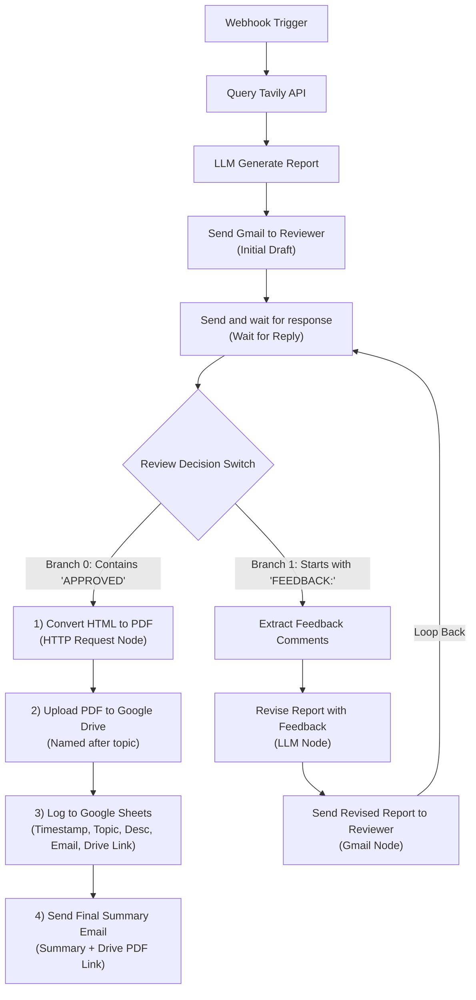

# n8n Research Pipeline

A complete, production-ready research ingestion, iterative review, and automated archiving pipeline connecting a minimalist dark-themed web form to an n8n workflow.

## Workspace Structure

```
/home/muaz/projects/n8n-research-pipeline/
├── index.html        # Minimalist single-column input form (no card containers)
├── style.css         # Dark slate theme styling with emerald green accent
├── app.js            # Form submission handler dispatching JSON to n8n webhook
├── workflow.json     # Complete end-to-end n8n workflow JSON with mapped OAuth2 credentials
└── README.md         # Full pipeline architecture, credentials setup, and documentation
```

---

## 1. Web Form Interface

### Features
- **Design Specifications**: Minimalist, dark-themed UI featuring a deep dark slate palette (`#0b1120`, `#0f172a`, `#1e293b`) with emerald green accent highlights (`#10b981`).
- **Layout**: Single-column stacked vertical layout with no card containers, bounding boxes, or card shadows. Form fields flow directly within the document canvas.
- **Fields Collected**:
  - `topic`: Primary query string passed directly to the search provider.
  - `subtopics`: Auxiliary domains or secondary angles for targeted search expansion.
  - `description`: Detailed research context, criteria, or constraints.
  - `reviewer_email`: Email address for downstream alert and review stages.
- **Client Logic (`app.js`)**: Asynchronously submits the JSON payload via `fetch` to the configured n8n webhook and displays responsive, minimalist feedback.

### Quick Preview
To serve the form locally:
```bash
python3 -m http.server 3000 --directory /home/muaz/projects/n8n-research-pipeline
```
Then open `http://localhost:3000` in your browser.

---

## 2. End-to-End Workflow Architecture (`workflow.json`)



---

## 3. Google OAuth2 Credentials Setup Guide

To resolve execution errors on **Gmail**, **Google Drive**, and **Google Sheets** nodes, configure an OAuth2 App in Google Cloud Console.

### Part A: Google Cloud Console Configuration

1. **Create or Select a Project**:
   - Go to [Google Cloud Console](https://console.cloud.google.com/).
   - Click the project dropdown (top left) and click **New Project** (e.g. `n8n-research-pipeline`).

2. **Enable Required Google APIs**:
   - Navigate to **APIs & Services** &rarr; **Library**.
   - Search for and enable each of the following:
     - **Gmail API**
     - **Google Drive API**
     - **Google Sheets API**

3. **Configure the OAuth Consent Screen**:
   - Navigate to **APIs & Services** &rarr; **OAuth consent screen**.
   - Choose **External** (or **Internal** if using Google Workspace) and click **Create**.
   - Fill in:
     - **App name**: `n8n Research Pipeline`
     - **User support email**: Your email
     - **Developer contact information**: Your email
   - Click **Save and Continue**.
   - On the **Scopes** page, click **Save and Continue**.
   - On the **Test Users** page, click **Add Users** and enter your Google account email. Click **Save and Continue**.

4. **Create OAuth 2.0 Client ID & Secret**:
   - Navigate to **APIs & Services** &rarr; **Credentials**.
   - Click **+ Create Credentials** &rarr; select **OAuth client ID**.
   - Set **Application type**: **Web application**.
   - Set **Name**: `n8n Client`.
   - Under **Authorized redirect URIs**, click **+ Add URI** and paste:
     ```
     http://localhost:5678/rest/oauth2-credential/callback
     ```
     *(If using a hosted domain or tunnel, replace `http://localhost:5678` with your base n8n URL, e.g. `https://n8n.yourdomain.com/rest/oauth2-credential/callback`)*.
   - Click **Create**. Copy your **Client ID** and **Client Secret**.

---

### Part B: Connect Credentials inside n8n

You can reuse the **same Client ID and Client Secret** across all three Google credential types:

1. Open your n8n interface (`http://localhost:5678`).
2. Go to **Credentials** (left menu) &rarr; click **Add Credential** (top right):

#### 1. Gmail (`Gmail OAuth2 API`)
- Search for **Gmail OAuth2 API**.
- Name it: `Gmail OAuth2 API`.
- Paste your **Client ID** and **Client Secret**.
- Click **Sign in with Google**. In the popup, choose your account, click **Advanced** &rarr; **Go to n8n (unsafe)**, and grant permissions.
- Click **Save**.

#### 2. Google Drive (`Google Drive OAuth2 API`)
- Click **Add Credential** &rarr; search for **Google Drive OAuth2 API**.
- Name it: `Google Drive OAuth2 API`.
- Paste the same **Client ID** and **Client Secret**.
- Click **Sign in with Google** and approve permissions.
- Click **Save**.

#### 3. Google Sheets (`Google Sheets OAuth2 API`)
- Click **Add Credential** &rarr; search for **Google Sheets OAuth2 API**.
- Name it: `Google Sheets OAuth2 API`.
- Paste the same **Client ID** and **Client Secret**.
- Click **Sign in with Google** and approve permissions.
- Click **Save**.

Once saved, import or refresh [workflow.json](file:///home/muaz/projects/n8n-research-pipeline/workflow.json) and all Google nodes will execute with valid authentication.
