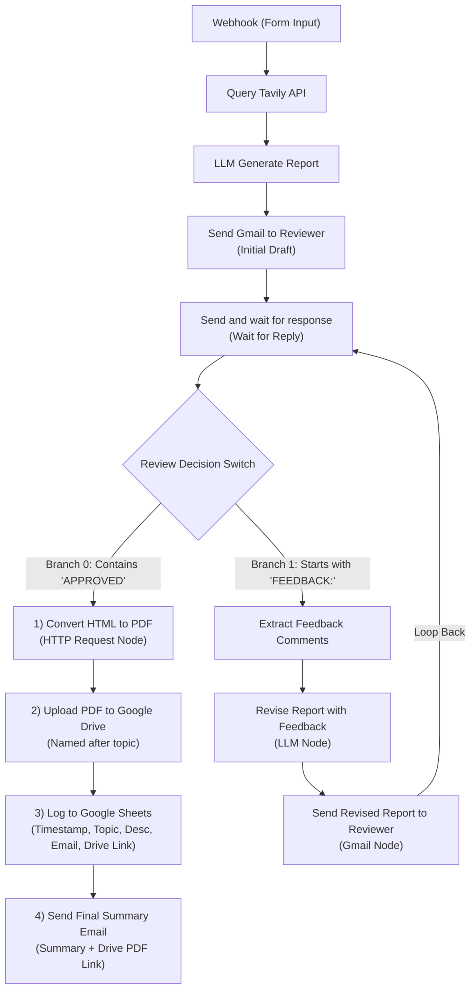

# n8n Research Pipeline

A complete, production-ready research ingestion, iterative review, and automated archiving pipeline connecting a minimalist dark-themed web form to an n8n workflow.

## Workspace Structure

```
/home/muaz/projects/n8n-research-pipeline/
├── index.html                       # Minimalist single-column input form (no card containers)
├── style.css                        # Dark slate theme styling with emerald green accent
├── app.js                           # Form submission handler dispatching JSON to n8n webhook
├── workflow.json                    # Complete n8n workflow JSON with guarded expressions
├── research-pipeline-corrected.json # Corrected workflow with verified OAuth2 IDs and execution guards
└── README.md                        # Full pipeline architecture, credentials, and expression safety guide
```

---

## 1. Web Form Interface

### Features
- **Design Specifications**: Minimalist, dark-themed UI featuring a deep dark slate palette (`#0b1120`, `#0f172a`, `#1e293b`) with emerald green accent highlights (`#10b981`).
- **Layout**: Single-column stacked vertical layout with no card containers, bounding boxes, or card shadows. Form fields flow directly within the document canvas.
- **Fields Collected**:
  - `topic`: Primary query string passed directly to the search provider.
  - `subtopics`: Auxiliary domains or secondary angles for targeted search expansion.
  - `description`: Detailed research context, criteria, or constraints.
  - `reviewer_email`: Email address for downstream alert and review stages.
- **Client Logic (`app.js`)**: Asynchronously submits the JSON payload via `fetch` to the configured n8n webhook and displays responsive, minimalist feedback.

---

## 2. End-to-End Workflow Architecture



---

## 3. Resilient Expression Handling in n8n

### A. Paired Item Lineage (`.first().json`)
When an n8n workflow passes through a Wait node (`sendAndWait`), conditional branching (`Switch`), or feedback loops, direct item-pairing is broken. To access initial trigger or upstream data from any downstream node without `No path back to referenced node` errors, expressions use `.first().json`:
```javascript
$('Webhook (Form Input)').first().json.body?.topic
```

### B. Unexecuted Node Guards (`.isExecuted`)
When conditional branches diverge (e.g. Approval vs Feedback), referencing a node that ran in the opposite branch or on a subsequent iteration causes `An expression references this node, but the node is unexecuted`. All cross-branch expressions are wrapped with `.isExecuted` guards:
```javascript
{{ $('Revise Report with Feedback').isExecuted ? $('Revise Report with Feedback').first().json.message?.content : ($('LLM Generate Report').isExecuted ? $('LLM Generate Report').first().json.message?.content : '') }}
```
