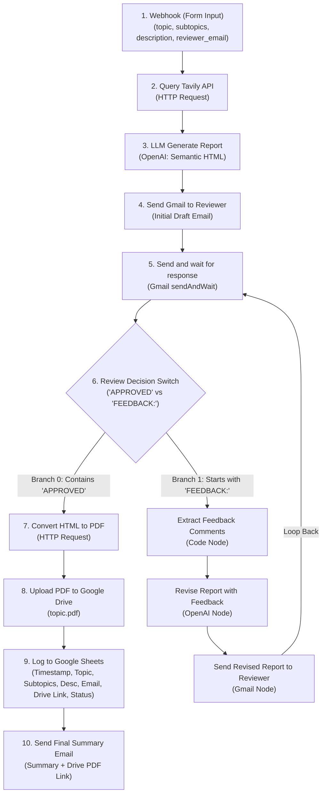

# AI Research Pipeline with Tavily and Human Approval

A production-ready research ingestion, automated synthesis, human-in-the-loop review, and archival pipeline connecting a custom dark-themed web form to an n8n workflow.

## Workspace Layout

```
/home/muaz/projects/n8n-research-pipeline/
├── index.html                       # Minimalist single-column input form (strictly no card containers)
├── style.css                        # Dark slate background with emerald green accent
├── app.js                           # Webhook dispatcher with input validation and feedback
├── workflow.json                    # Complete n8n workflow with hardcoded credentials and safe expressions
├── research-pipeline-corrected.json # Synchronized copy for import compatibility
└── README.md                        # Documentation and configuration reference
```

---

## 1. Minimalist Web Form Interface

- **Theme & Colors**: Dark slate background (`#0b1120`, `#0f172a`), emerald green accent (`#10b981`).
- **Layout**: Single-column vertically stacked layout flowing directly into the canvas. Strictly excludes card containers, outer boxes, or container drop shadows.
- **Fields Collected**:
  - `topic`: Core search query.
  - `subtopics`: Specific research angles or secondary focus areas.
  - `description`: Detailed instructions, context, or criteria.
  - `reviewer_email`: Recipient for review drafts and final notifications.
- **Client Script (`app.js`)**: Validates required fields and posts a JSON payload to the configured n8n webhook endpoint.

---

## 2. n8n Workflow Architecture



---

## 3. Injected Credential Mappings

All nodes requiring credentials have their properties mapped to the target IDs:

| Service | Credential Name / Type | Injected ID | Nodes Configured |
| :--- | :--- | :--- | :--- |
| **OpenAI** | `OpenAI API` / `openAiApi` | `4` | `OpenAI Chat Model` (GPT-4o) |
| **Gmail** | `Gmail OAuth2 API` / `gmailOAuth2` | `uypNuUhTfvPwNQY1` | `Send Draft for Review`, `Reviewer Reply Trigger`, `Send Done Email`, `Resend Revised Draft` |
| **Google Drive** | `Google Drive OAuth2 API` / `googleDriveOAuth2Api` | `vCOWlNFHjPCxhkkp` | `Upload PDF to Drive` |
| **Google Sheets** | `Google Sheets OAuth2 API` / `googleSheetsOAuth2Api` | `ekUCZ7Zpwvaz2QzN` | `Create Request State Row`, `Lookup Request Row`, `Mark Request Completed`, `Save Revised Report` |
| **PDFShift** | `Header Auth` / `httpHeaderAuth` | `4vMPI1bWAqXjvL5N` | `Convert HTML to PDF` |
| **Tavily** | `Header Auth` / `httpHeaderAuth` | `21DkWLgJ6u58XxNo` | `Search Topic with Tavily` |
| **Spreadsheet ID**| Google Sheets Document ID | `1_NXZZylBDm6DqV5zjv8iUayyYEIrktSqx8gOdYWtUUc` | All 4 Google Sheets Nodes |

---

## 4. Expression Safety & Lineage Integrity

- **Global Lineage**: All references to initial trigger fields use `$('Webhook (Form Input)').first().json...` instead of `.item.json`, ensuring data remains accessible after the human-in-the-loop Wait node.
- **Unexecuted Branch Fallbacks**: Downstream nodes safely fall back without throwing unexecuted branch errors:
  ```javascript
  {{ $('Revise Report with Feedback').isExecuted ? ($('Revise Report with Feedback').first().json.reportHtml || $('Revise Report with Feedback').first().json.message?.content || $('Revise Report with Feedback').first().json.text) : ($('LLM Generate Report').first().json.reportHtml || $('LLM Generate Report').first().json.message?.content || $('LLM Generate Report').first().json.text) }}
  ```
