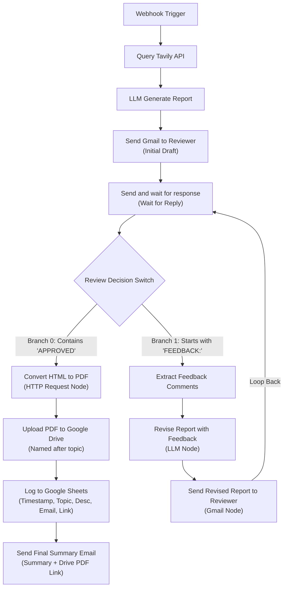

# n8n Research Pipeline

A complete, production-ready research ingestion, iterative review, and automated archiving pipeline connecting a minimalist dark-themed web form to an n8n workflow.

## Workspace Structure

```
/home/muaz/projects/n8n-research-pipeline/
├── index.html        # Minimalist single-column input form (no card containers)
├── style.css         # Dark slate theme styling with emerald green accent
├── app.js            # Form submission handler dispatching JSON to n8n webhook
├── workflow.json     # Complete end-to-end n8n workflow JSON with Approval & Feedback branches
└── README.md         # Full pipeline architecture and documentation
```

---

## 1. Web Form Interface

### Features
- **Design Specifications**: Minimalist, dark-themed UI featuring a deep dark slate palette (`#0b1120`, `#0f172a`, `#1e293b`) with emerald green accent highlights (`#10b981`).
- **Layout**: Single-column stacked vertical layout with no card containers, bounding boxes, or card shadows. Form fields flow directly within the document canvas.
- **Fields Collected**:
  - `topic`: Primary query string passed directly to the search provider.
  - `subtopics`: Auxiliary domains or secondary angles for targeted search expansion.
  - `description`: Detailed research context, criteria, or constraints.
  - `reviewer_email`: Email address for downstream alert and review stages.
- **Client Logic (`app.js`)**: Asynchronously submits the JSON payload via `fetch` to the configured n8n webhook and displays responsive, minimalist feedback.

### Quick Preview
To serve the form locally:
```bash
python3 -m http.server 3000 --directory /home/muaz/projects/n8n-research-pipeline
```
Then open `http://localhost:3000` in your browser.

---

## 2. End-to-End Workflow Architecture (`workflow.json`)



---

### Pipeline Nodes Breakdown

#### Core Trigger & Search
1. **Webhook Trigger Node (`n8n-nodes-base.webhook`)**: Receives `topic`, `subtopics`, `description`, and `reviewer_email`.
2. **Query Tavily API (`n8n-nodes-base.httpRequest`)**: Executes an advanced web search against `https://api.tavily.com/search`.
3. **LLM Generate Report (`n8n-nodes-base.openAi`)**: Ingests form inputs and Tavily findings to synthesize a clean, semantic HTML report (`<h1>`, `<h2>`, `<p>`, `<ul>`/`<li>`).
4. **Send Gmail to Reviewer (`n8n-nodes-base.gmail`)**: Dispatches the initial report to `reviewer_email` with instructions to reply with `'APPROVED'` or `'FEEDBACK: [comments]'`.
5. **Send and wait for response (`n8n-nodes-base.gmail`)**: Pauses workflow execution using human-in-the-loop operation (`sendAndWait`).
6. **Review Decision Switch (`n8n-nodes-base.switch`)**: Evaluates incoming reply text.

#### Approval Branch (`APPROVED`)
7. **Convert HTML to PDF (`n8n-nodes-base.httpRequest`)**: Calls an HTML-to-PDF generation API with the latest HTML report, receiving the compiled PDF binary.
8. **Upload PDF to Google Drive (`n8n-nodes-base.googleDrive`)**: Uploads the binary to Google Drive, named `{{ topic }}.pdf`.
9. **Log to Google Sheets (`n8n-nodes-base.googleSheets`)**: Appends an audit row logging:
   - `timestamp`: ISO timestamp
   - `topic`: Research topic
   - `description`: Context/parameters
   - `reviewer_email`: Reviewer's address
   - `drive_link`: Direct Google Drive link (`webViewLink`)
10. **Send Final Summary Email (`n8n-nodes-base.gmail`)**: Sends a completion notification to the reviewer with a task summary and the direct Google Drive link to the final PDF report.

#### Feedback Branch (`FEEDBACK:`)
11. **Extract Feedback Comments (`n8n-nodes-base.code`)**: Strips the `FEEDBACK:` prefix and extracts reviewer instructions.
12. **Revise Report with Feedback (`n8n-nodes-base.openAi`)**: Refines the existing HTML report to address reviewer feedback.
13. **Send Revised Report to Reviewer (`n8n-nodes-base.gmail`)**: Dispatches the revised draft and loops back to **Send and wait for response**.
